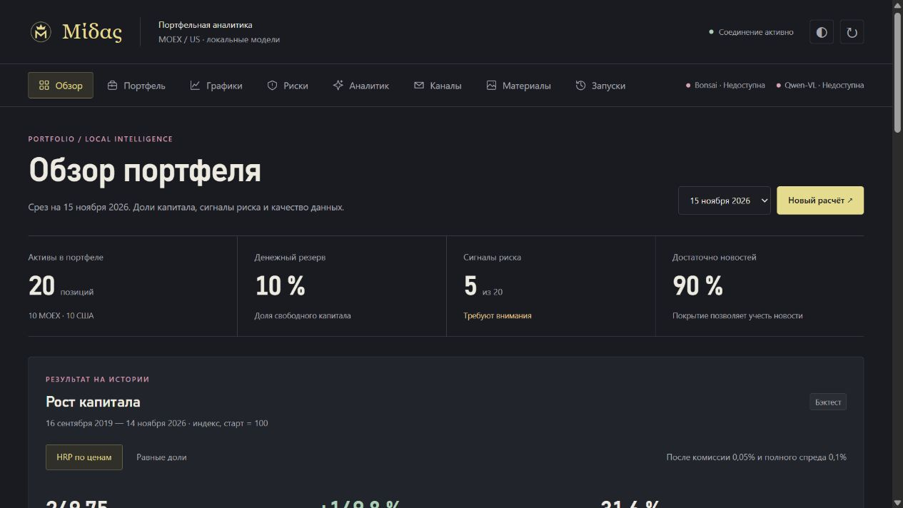
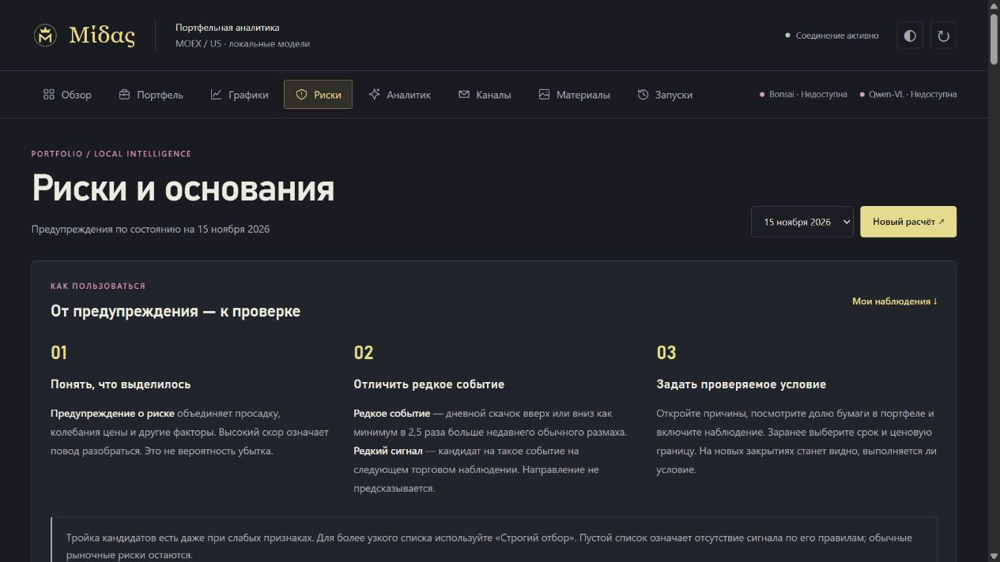
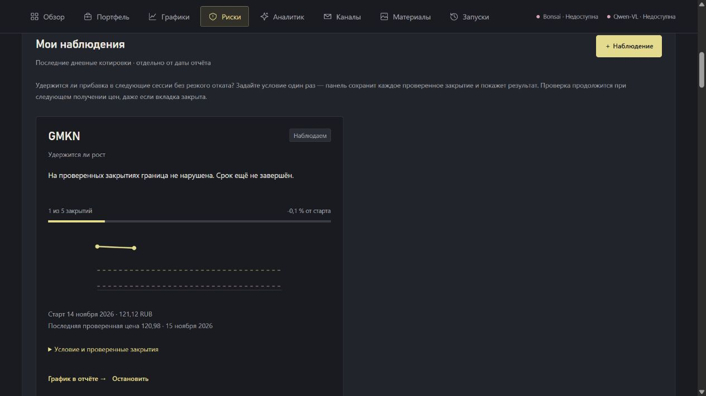
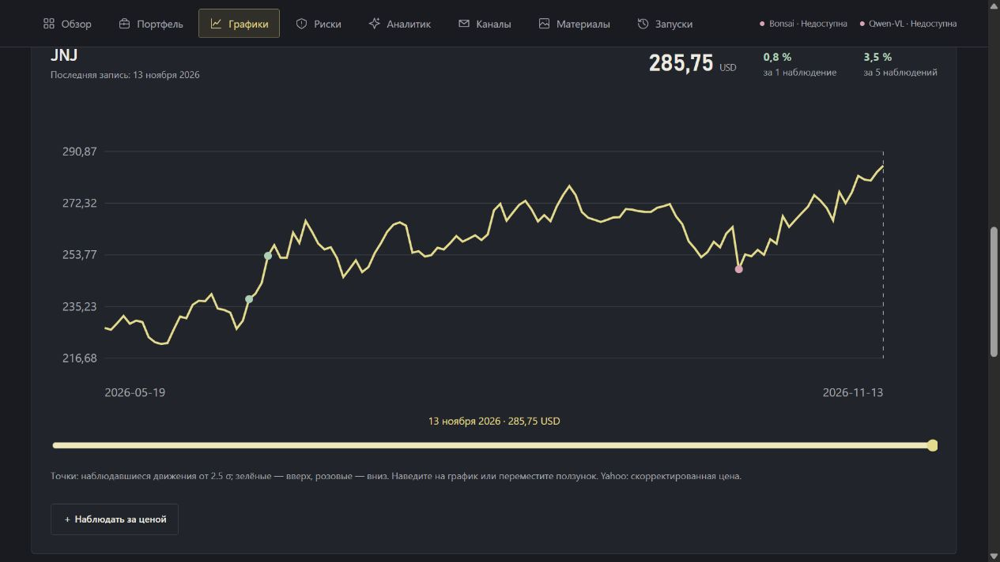

# Μίδας

**Локальная аналитика портфеля, рисков и движения акций.**

Μίδας (Мидас) объединяет котировки MOEX и американских акций, новости, Telegram,
судебные сообщения и изображения в одной панели. Состав портфеля рассчитывается
детерминированным HRP. Локальные модели разбирают сообщения и документы, объясняют
результаты и отвечают на вопросы по сохранённым данным.

## Панель

### Обзор портфеля

Доли активов, денежный резерв, изменения цен и основные предупреждения.



### Риски и наблюдения

Объяснение редких сигналов, причины предупреждений и условия наблюдения за ценой.



Проверка выбранного условия на новых закрытиях с сохранением прогресса:



### Графики

Архивные закрытия, изменение за период, отметки необычных движений и выбор бумаги.



Скриншоты показывают сохранённые расчёты на дату, указанную в интерфейсе.
Они иллюстрируют возможности программы и не являются потоком текущих котировок.

## Возможности

- **Портфель:** HRP, ограничения долей, денежный резерв, кластеры сходного поведения.
- **Данные:** MOEX ISS, Yahoo Finance, RSS, Google News, публичные Telegram-каналы.
- **Риски:** хвостовые движения, просадки, изменение волатильности, макроусловия,
  календарь отчётности и объяснение причин предупреждения.
- **Наблюдения:** удержание роста, восстановление после снижения и достижение
  заданного размера дневного движения; история условий и результатов.
- **Локальный анализ:** разметка сообщений, рецензии и вопросы по замороженному отчёту
  с проверяемыми ссылками на исходные факты.
- **Материалы:** PNG/JPEG/WebP, локальное распознавание и CLIP-эмбеддинги, отдельное
  сравнение портфельных сценариев и явное включение выбранного набора на будущие дни.
- **Проверка на истории:** walk-forward, комиссии и спред, сравнение с равными долями,
  абляции, калибровка и проверка прогнозов после завершения их горизонта.
- **Фоновые задания:** локальная очередь и ежедневный запуск через Windows Task Scheduler.

## Требования

Проверяемая конфигурация: **Windows x64 и Python 3.12**. Численные расчёты и тесты
не требуют GPU. Текстовый анализ и распознавание изображений используют отдельно
установленные локальные модели. Для запуска крупных моделей необходимы подходящие
RAM/VRAM; без моделей доступен расчёт по ценам.

Python-библиотеки зафиксированы вместе с транзитивными зависимостями:

| Файл | Назначение | Окружение |
| --- | --- | --- |
| [requirements.txt](requirements.txt) | Панель, дневной расчёт, рыночные источники и тесты | `.venv` |
| [requirements-images.txt](requirements-images.txt) | PyTorch, Transformers, CLIP-эмбеддинги | `.venv-images` |
| [requirements-research.txt](requirements-research.txt) | TabM, NGBoost, XGBoostLSS и полная среда исследований | `.venv-research` |

Наборы для исследований и основной панели устанавливаются раздельно: XGBoostLSS
требует более старые версии pandas, NumPy и SciPy. GGUF-модели, CLIP-веса и бинарники
llama.cpp не входят в Python requirements или Git-репозиторий.

## Быстрый старт

Все команды выполняются из корня проекта в PowerShell.

```powershell
py -3.12 -m venv .venv
.venv\Scripts\python -m pip install -r requirements.txt
.venv\Scripts\python -m pip install --no-deps --no-build-isolation -e .
Copy-Item configs/example.yaml configs/default.yaml
```

`configs/default.yaml` — локальная настройка: она исключена из Git. В существующей
установке сохраните свой файл. В примере перечислены все обязательные параметры;
неизвестные ключи и неправильные типы приводят к ошибке конфигурации.

Запустите панель:

```powershell
scripts\WEB_PANEL.ps1 -Action Start
```

Откройте **[http://127.0.0.1:8765](http://127.0.0.1:8765/)**. Первый дневной расчёт можно
создать кнопкой в панели или выполнить из командной строки:

```powershell
.venv\Scripts\python -m midas daily --no-llm
```

Для этой команды нужны доступные сетевые источники котировок. Полный запуск с
локальной моделью: `scripts\RUN_DAILY.cmd`. Команда `midas` также доступна в
`.venv\Scripts` после установки проекта.

## Демо без сети и моделей

Демонстрационные цены и новости создаются генератором. Все результаты демо
хранятся в `.demo/`; рабочие `data/` и `reports/` не используются.

```powershell
New-Item -ItemType Directory -Force .demo\configs | Out-Null
Copy-Item configs/default.yaml .demo/configs/demo.yaml
.venv\Scripts\python scripts/make_demo_fixture.py fixtures/demo
.venv\Scripts\python -m midas --config .demo/configs/demo.yaml daily --no-llm --source fixture --fixture-dir fixtures/demo
.venv\Scripts\python -m midas --config .demo/configs/demo.yaml web --port 8766
```

Демо-панель: [http://127.0.0.1:8766](http://127.0.0.1:8766/). Данные синтетические:
доходности демо не характеризуют реальную стратегию. Флаг `--config` всегда ставится
**до** подкоманды.

## Как пользоваться рисками

Предупреждение о риске — сочетание наблюдаемых факторов, а не вероятность убытка.
Кандидат на редкое событие — бумага, выделенная для проверки необычного движения
на следующем торговом наблюдении. Направление движения такой отбор не предсказывает.
По умолчанию панель показывает строгий отбор; пустой список допустим.

Нажмите **«Наблюдать за ценой»**, выберите бумагу, срок 3/5/10 торговых записей и порог:

| Условие | Что проверяется |
| --- | --- |
| Удержится ли рост | Каждое закрытие сохраняет не меньше половины прибавки предыдущих пяти наблюдений; откат от максимального закрытия после старта не превышает заданный процент. |
| Продолжится ли восстановление | К концу срока отыграна половина снижения предыдущих пяти наблюдений, без превышения допустимого отката на всём пути. |
| Будет ли резкое движение | Изменение между соседними закрытиями достигло заданного процента вверх или вниз. |

Начальное значение 3% можно изменить; это не оптимизированный торговый уровень.
Наблюдения начинают отсчёт с последних доступных дневных котировок, независимо от
выбранной даты отчёта. Новые цены получает дневной сбор. Панель проверяет обновления
каждые 30 секунд; закрытая вкладка не мешает работе сервера.

Пропуски котировок не считаются успешными сессиями. Внутридневные откаты не проверяются.
Пересечение границы сохраняется, даже если затем цена восстановилась. Завершённый
результат не меняется от последующих цен. Пересмотр исходной истории приостанавливает
проверку. Калькулятор в «Рисках» позволяет оценить влияние заданного падения одной
позиции при неизменных остальных ценах и валютных курсах.

## Локальные модели

Текстовый сервер должен предоставлять совместимый API на `127.0.0.1:8080`.
В `llm.runtime_root` укажите каталог, внутри которого находятся `llm_runtime/`,
`llama-server.exe`, сопутствующие библиотеки и текстовая GGUF-модель. При значении
`.` ожидается каталог `llm_runtime/` в корне проекта.

```powershell
scripts\START_LLM.cmd
.venv\Scripts\python -m midas probe
```

Пример конфигурации рассчитан на Bonsai. Доступны переопределения
`MIDAS_LLM_ENDPOINT` и `MIDAS_LLM_MODEL`. Клиент допускает только loopback HTTP;
облачные адреса, перенаправления и прокси окружения для запросов к модели не используются.

Для Qwen2.5-VL требуется отдельный сервер на `127.0.0.1:8081`, модель и mmproj.
Поместите совместимый llama.cpp в `llm_runtime/`, затем выполните:

```powershell
.venv\Scripts\python scripts/install_vision_model.py --runtime-dir ./llm_runtime
.venv\Scripts\python -m midas vision start --wait
```

Установщик скачивает GGUF и mmproj в `llm_runtime_vision/`. Эти файлы в Git не попадают.

### Обработка изображений

```powershell
py -3.12 -m venv .venv-images
.venv-images\Scripts\python -m pip install -r requirements-images.txt
```

В конфигурации указан локальный CLIP `openai/clip-vit-large-patch14`, ревизия
`32bd64288804d66eefd0ccbe215aa642df71cc41`. Загрузите её один раз перед использованием:

```powershell
.venv-images\Scripts\python -c "from huggingface_hub import snapshot_download; snapshot_download('openai/clip-vit-large-patch14', revision='32bd64288804d66eefd0ccbe215aa642df71cc41')"
```

Во время обработки материалы читаются локально; веса не скачиваются автоматически.
Локальная модель извлекает признаки, численные уровни и изменения весов считает код.

### Исследовательские модели

```powershell
py -3.12 -m venv .venv-research
.venv-research\Scripts\python -m pip install -r requirements-research.txt
.venv-research\Scripts\python -m pip install --no-deps --no-build-isolation -e .
scripts\TRAIN_TOP3.ps1
```

Первый запуск собирает отдельный снимок цен. `-SkipFetch` использует готовый снимок;
`-TrainingPython` позволяет указать другую среду. Результаты обучения не заменяют
действующий детектор автоматически. Подтверждение качества на истории не равно
подтверждению доходности портфеля.

## Расписание и обслуживание

```powershell
scripts\SCHEDULE_DAILY.ps1 -Action Install -AtTime 07:00
scripts\SCHEDULE_DAILY.ps1 -Action Status
scripts\WEB_PANEL.ps1 -Action Status
scripts\WEB_PANEL.ps1 -Action Stop
```

Планировщик работает по времени Москвы. Пользователь должен войти в Windows;
экран может быть заблокирован. Повтор готового дня не пересчитывает портфель,
одновременные запуски защищены общим lock. Старые пропущенные даты задним числом
не генерируются. Для существующих установок сохранён идентификатор задания
`PortagentDaily`, чтобы не создавать второй ежедневный запуск.

Панель доступна только локально. Внешний доступ и VPN в эту конфигурацию не входят.
Очередь принимает только предусмотренные действия, с проверкой Host/Origin,
локальной сессии и CSRF.

## Проверка на истории

```powershell
.venv\Scripts\python -m midas backtest --fetch --rebalance-days 21
.venv\Scripts\python -m midas settle --all
.venv\Scripts\python -m midas quality
.venv\Scripts\python -m midas ablation --fixture-dir fixtures/demo
```

Бэктест удерживает позиции между ребалансами, учитывает комиссии, половину полного
спреда и первый вход. Gross и net показываются отдельно. FX не моделируется;
корпоративные действия MOEX учтены не полностью. Синтетические и реальные данные
следует сравнивать в отдельных экспериментах.

## Проверки

```powershell
$env:OPENBLAS_NUM_THREADS = '1'
$env:OMP_NUM_THREADS = '1'
$env:MKL_NUM_THREADS = '1'
.venv\Scripts\python -m pytest -q --ignore=tests/test_ablation.py
.venv\Scripts\python -m pytest -q tests/test_ablation.py
```

Тесты полностью офлайн. Абляции запускаются отдельно из-за наблюдавшейся на Windows
нестабильности численных библиотек в одном длинном процессе. Workflow GitHub Actions
повторяет эти проверки на Windows и Python 3.12.

## Хранение и воспроизводимость

- `configs/example.yaml` — полный пример конфигурации в репозитории.
- `configs/default.yaml` — локальная конфигурация, исключённая из Git.
- `data/raw/` — неизменяемые исходные снимки и SHA-манифесты.
- `data/forecasts/`, `data/settlement/` — прогнозы до события и результаты проверки.
- `data/history/` — накопленная история; `data/events/` — датированные события источников.
- `data/runtime/` — очередь, расписание и наблюдения; `data/cache/` — производные кэши.
- `reports/` — отчёты и результаты экспериментов.
- `tests/`, `scripts/`, `docs/` — проверки, служебные команды и документация.

Рабочие данные, модели, виртуальные окружения и локальные настройки исключены из Git.
Веса назначает HRP; локальные модели не выдают готовый вектор весов. Сбой источника
или модели отражается в отчёте и допускает деградацию до доступных данных.

[Архитектура](docs/ARCHITECTURE.md) · [План развития](docs/ROADMAP.md)
